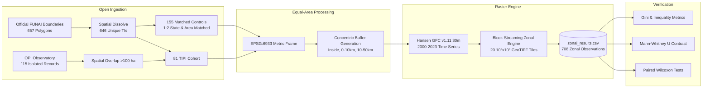

# Forest Loss Pressure on Indigenous Lands with Uncontacted Peoples in the Brazilian Amazon (2000–2023)

<div align="center">

[](https://opensource.org/licenses/MIT)
[](https://www.python.org/)
[]()
[]()
[]()

**An open-data, reproducible geospatial assessment of territorial buffering and deforestation frontiers across 81 Indigenous Lands hosting isolated peoples (*TIPI*) in the Brazilian Amazon.**

[**Key Findings**](#-key-scientific-findings) • [**Methodology**](#-methodological-architecture) • [**Quickstart**](#-quickstart--reproduction) • [**Data Dictionary**](#-data-dictionary) • [**Ethics**](#-ethical-data-governance) • [**Citation**](#-citation)

</div>

---

## 📌 Executive Summary

Brazil hosts the world's largest concentration of uncontacted (isolated) Indigenous peoples (*povos indígenas isolados*), who live in voluntary avoidance of national society and face extreme mortality risks (18%–20% per epidemic) from contact-related pathogens. While extensive literature proves that Indigenous Lands in the Amazon inhibit deforestation generally, prior research uniformly treated Indigenous Lands as a homogeneous legal tenure category.

This project delivers the **first territory-level quantitative assessment** isolating the **81 Indigenous Lands hosting uncontacted peoples (TIPI)**, covering 89.3 million hectares, and evaluates their internal forest loss against:
1. **Concentric Buffer Rings** (0–10 km and 10–50 km) measuring surrounding landscape frontier pressure.
2. **155 Matched Non-Isolated Indigenous Lands** controlling for state-level governance (UF) and territorial land area.

Analysis covers **24 continuous years (2000–2023)** using the 30-meter Hansen/UMD Global Forest Change dataset (v1.11, canopy cover >30%).

---

## 🔬 Key Scientific Findings

All numbers are computed from territory-level zonal counts and verified through non-parametric inference:

```text
==================================================================================================
Zone / Comparison Cohort               n     Median Loss Share [IQR]       Mean    Total Forest Lost
==================================================================================================
TIPI Interior (Inside Boundary)       81     1.01% [0.29% – 3.45%]        3.13%      1,533,682 ha
TIPI 0–10 km Surrounding Ring         81     3.66% [0.83% – 14.50%]       9.98%      2,880,999 ha
TIPI 10–50 km Landscape Ring         81     5.30% [1.22% – 17.87%]      10.98%     16,344,613 ha
Matched Control Lands (Inside)       155     2.51% [0.92% – 7.29%]        6.75%      1,006,569 ha
==================================================================================================
```

### Core Statistical Highlights
* **Stark Territorial Buffering (Within-Unit Contrast):** Forest loss inside TIPI was **3.6 times lower** than in immediate 0–10 km buffer rings ($W = 274.0, p = 6.66 \times 10^{-11}$, Cohen's $d_z = -0.725$, rank-biserial $r = -0.835$) and **5.3 times lower** than in wider 10–50 km landscape buffers ($W = 149.0, p = 1.11 \times 10^{-12}$, $r = -0.910$).
* **Matched Contrast (Tenure Effect):** Uncontacted peoples' lands lost **2.5 times less forest** internally than comparable non-isolated Indigenous Lands within the same state and size cohort ($U = 4252.0, p = 4.77 \times 10^{-5}$, rank-biserial $r = -0.323$).
* **Extreme Threat Concentration:** Deforestation in surrounding buffers is heavily concentrated (Gini index = **0.631**). The **top 10 highest-pressure territories account for 48.48% (1.40 million ha)** of all 0–10 km ring loss across the study.
* **Institutional Fortresses Under Assault:** In **Uru-Eu-Wau-Wau (RO)**, the external 0–10 km buffer suffered 222,349 ha of clearing (35.15% ring loss share), yet inside the territory, deforestation was constrained to **2.27%**. In **Baú (PA)**, surrounding clearing reached 153,702 ha (23.54% ring loss share), while internal loss was held to just **0.25%**.
* **Frontier Drivers:** Surrounding deforestation correlates significantly with proximity to municipal urban centers ($\rho = -0.457, p = 1.81 \times 10^{-5}$), capturing diffuse agricultural and settlement expansion.

---

## 🏗️ Methodological Architecture



---

## 📂 Repository Structure

```text
amazon-tipi-forest-loss/
├── README.md                      # Primary project documentation
├── LICENSE                        # MIT Open Source License
├── CITATION.cff                   # Machine-readable citation metadata
├── requirements.txt               # Pinned Python package dependencies
├── config.yaml                    # Analytical parameters, CRS, thresholds, seeds
├── data/
│   ├── README.md                  # Comprehensive data dictionary & schemas
│   └── derived/
│       ├── zonal_results.csv      # Primary 708-row territorial loss dataset
│       ├── accessibility.csv      # Infrastructure distances in EPSG:6933
│       ├── summary_stats.csv      # Aggregated summary statistics by zone & group
│       ├── statistical_tests.csv  # Verified hypothesis test outputs & adjusted p-values
│       ├── key_stats.json         # Single source of truth for manuscript statistics
│       └── tile_log.csv           # Processing log of 20 Hansen GFC raster tiles
├── paper/
│   ├── manuscript.tex             # Master LaTeX manuscript
│   ├── sec_*.tex                  # Modular manuscript sections (intro, methods, results, backmatter)
│   ├── references.bib             # 23 verified BibTeX citations with direct DOIs
│   ├── manuscript.pdf             # Compiled submission-ready PDF
│   ├── figures/                   # 300 dpi publication-grade figures
│   └── tables/                    # Formatted LaTeX publication tables
├── figures/                       # Standalone high-resolution maps and plots (fig1–fig5)
├── tables/                        # Standalone LaTeX tables (tab_descriptive, tab_tests, tab_top10)
├── scripts/
│   └── verify_stats.py            # Standalone zero-dependency verification script
├── src/
│   ├── acquisition/               # Data scrapers for FUNAI, OPI, and RAISG APIs
│   └── analysis/                  # Zonal extraction engine and statistical models
├── tests/
│   ├── test_smoke.py              # Pytest suite with geometry & transform regression tests
│   └── conftest.py                # Pytest configuration
└── documentation/
    ├── ethics_protocol.md         # 6-point Indigenous data governance protocol
    ├── search_strategy.md         # Literature verification strategy & queries
    └── literature_matrix.csv      # Matrix of 26 evaluated scientific sources
```

---

## ⚡ Quickstart & Reproduction

Reproduce 100% of numerical calculations, sample sizes, Wilcoxon tests, Mann-Whitney U statistics, and Gini concentration indices in under 2 seconds:

### 1. Clone Repository
```bash
git clone https://github.com/shadab80k/amazon-tipi-forest-loss.git
cd amazon-tipi-forest-loss
```

### 2. Environment Setup
```bash
python -m venv .venv

# On Windows:
.venv\Scripts\activate

# On Linux / macOS:
source .venv/bin/activate

pip install -r requirements.txt
```

### 3. Run Statistical Verification
```bash
python scripts/verify_stats.py
```

*Terminal Output:*
```text
=======================================================
SAMPLE SIZES:
  TIPI territories: 81
  Matched Control territories: 155
=======================================================
--- 1. DESCRIPTIVE STATISTICS ---
TIPI Inside:     1.01% [0.29% - 3.45%] | Mean: 3.13% | Total: 1,533,682 ha
TIPI Ring 1:      3.66% [0.83% - 14.50%] | Mean: 9.98% | Total: 2,880,999 ha
TIPI Ring 2:      5.30% [1.22% - 17.87%] | Mean: 10.98% | Total: 16,344,613 ha
Controls Inside:  2.51% [0.92% - 7.29%] | Mean: 6.75% | Total: 1,006,569 ha

--- 2. PRIMARY HYPOTHESIS TESTS ---
H1a (Inside vs Ring 1): Wilcoxon W=274.0, p=6.6640e-11 (Holm-adj p=2.6656e-10)
H1b (Inside vs Ring 2): Wilcoxon W=149.0, p=1.1065e-12 (Holm-adj p=5.5324e-12)
Group Contrast (TIPI vs Controls): Mann-Whitney U=4252.0, p=4.7701e-05 (Holm-adj p=9.5402e-05)
H2a (Distance to City): Spearman rho=-0.4568, p=1.8111e-05 (Holm-adj p=5.4332e-05)

--- 3. CONCENTRATION & INEQUALITY METRICS ---
Gini coefficient of Absolute 0-10 km Ring Loss (ha): 0.6315
Gini coefficient of Ring Loss Share (%):            0.6075
Top 10 share of aggregate 0-10 km ring loss:        48.48% (1,396,820 ha)
```

---

## 📊 Data Dictionary

| File | Description | Primary Columns |
|---|---|---|
| `data/derived/zonal_results.csv` | Full territory-level time-series (708 rows $\times$ 39 cols) | `ti_name`, `has_isolated`, `is_control`, `uf`, `fase`, `area_ha_official`, `zone`, `tree2000_px`, `loss_px_2000_2023`, `loss_share_tree2000`, `loss_ha_approx`, `loss_px_y2001`–`loss_px_y2023` |
| `data/derived/accessibility.csv` | Geographic distances computed in EPSG:6933 | `ti_name`, `has_isolated`, `dist_highway_km`, `dist_railway_km`, `dist_city_km` |
| `data/derived/summary_stats.csv` | Summary distributions by analytical cohort | `group`, `zone`, `n`, `median_loss_share`, `mean_loss_share`, `iqr_lo`, `iqr_hi`, `total_loss_ha` |
| `data/derived/statistical_tests.csv` | Exact non-parametric test statistics | `test`, `n_pairs_with_diff`, `wilcoxon_W`, `wilcoxon_p`, `cohens_dz`, `rank_biserial_r`, `p_holm_adj` |
| `data/derived/key_stats.json` | JSON single source of truth | Machine-readable anchors for LaTeX text integration |

---

## 🛡️ Ethical Data Governance

Research involving isolated Indigenous peoples is bounded by binding international and constitutional norms:

1. **Non-Contact Principle:** This study complies with FUNAI's official 1987 no-contact policy, ILO Convention 169, and UNDRIP. No field work, overflights, interviews, or interactions of any kind were proposed or conducted.
2. **Zero Location Disclosure:** **No point coordinates, encampment locations, or sensitive sighting records are published.** The OPI isolated-peoples record layer (`te_amz_povos_isolados`) was used solely locally to link presence to gazetted territorial names. All outputs are strictly aggregated to legally established Indigenous Land (*Terra Indígena*) boundaries (public policy artifacts).
3. **Repository Safeguards:** The repository `.gitignore` blocks raw point files (`*.geojson`, `data/raw/`) from ever being committed to public version control.

---

## 📖 Citation

If you use this dataset, methodology, or code in your academic work, please cite:

```bibtex
@article{shadab2026tipi,
  author    = {Shadab, Mohd},
  title     = {Forest Loss Pressure on Indigenous Lands with Uncontacted Peoples in the Brazilian Amazon: An Open-Data Geospatial Assessment (2000--2023)},
  journal   = {Remote Sensing Applications: Society and Environment},
  year      = {2026},
  note      = {Under peer review. Code and data repository: https://github.com/shadab80k/amazon-tipi-forest-loss}
}
```

---

## 📜 License

- **Code & Pipelines:** [MIT License](LICENSE) © 2026 Mohd Shadab.
- **Data & Documentation:** [Creative Commons Attribution 4.0 International (CC-BY 4.0)](https://creativecommons.org/licenses/by/4.0/).
